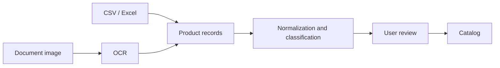

# MegaShop — Intelligent Retail Management

A retail management application built with Next.js, TypeScript and Supabase.

## Product imports

One of the problems I wanted to address was the amount of manual work involved in entering products from supplier documents.

The import module accepts CSV and Excel files as well as photographs of documents. Spreadsheet data is parsed using XLSX. Images go through an OCR workflow backed by a vision model. The application also combines keyword-based and model-based classification to assign product categories.



The review step matters: an incorrect quantity, barcode or cost can affect stock and pricing.

The application also includes a dashboard, product catalog, pricing, location-aware inventory and Supabase authentication. AI provider calls are handled through server routes.

## Development

```bash
npm install
npm run dev
```

Open `http://localhost:3000`. Configure a development Supabase project and the required environment variables before using authenticated workflows. The OCR and classification endpoints also require model provider configuration.

Other scripts: `npm run build`, `npm run start`, `npm run lint`.

The system is under active development. I'm still working on transaction consistency and access-control validation; the public code should not be treated as a production security reference.

[Related architecture notes](https://github.com/emamoreno7/emamoreno7/blob/main/showcase/enterprise-saas.md)
