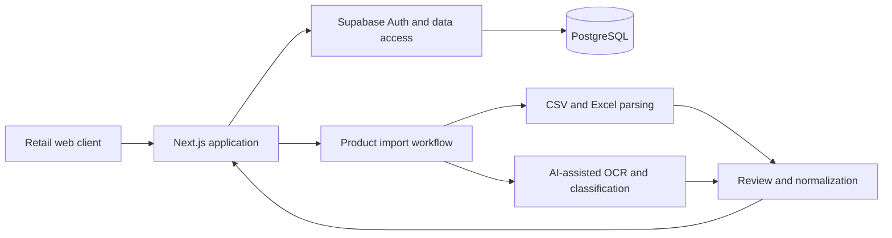

# MegaShop — Intelligent Retail Management

**Retail operations, inventory workflows and AI-assisted product intake.**

Active development · [Engineering portfolio](https://github.com/emamoreno7)

## Overview

MegaShop is a web-based retail management system designed to bring commercial operations, product information and purchasing workflows into a unified interface. The application combines conventional business software with AI-assisted document processing to reduce manual catalog entry.

## Application modules

| Module | Focus |
| --- | --- |
| Dashboard | Operational overview and navigation |
| Catalog | Product identifiers, categories, stock and pricing |
| Product intake | CSV, Excel and image-based document imports |
| AI-assisted classification | Product categorization using model-based and keyword approaches |
| Authentication | Supabase-backed sign-in and session handling |

## Architecture



High-level architecture; individual data flows depend on the current implementation.

## Engineering focus

- Structured product intake with normalization and review of imported records.
- Separation of authentication, application workflows and persistence.
- Location-aware inventory and role-aware interfaces.
- Server-side model integrations rather than exposing provider secrets to the browser.
- Explicit attention to transactional consistency, access control and operational auditing.

## Technology

Next.js · React · TypeScript · Supabase / PostgreSQL · Tailwind CSS · Groq SDK · XLSX

## Local development

```bash
npm install
npm run dev
```

Open `http://localhost:3000`. A configured Supabase environment is required for authenticated data workflows. AI-assisted imports require an appropriately configured model provider. Use development credentials and test data, never a live customer database.

Available scripts: `npm run build`, `npm run start` and `npm run lint`.

## Maturity and security

This is an active application development project. The repository contains application modules and integrations; this overview does not certify production readiness, database authorization coverage or end-to-end transaction correctness. AI-generated product data should be reviewed before operational use.

[Enterprise SaaS architecture case study](https://github.com/emamoreno7/emamoreno7/blob/main/showcase/enterprise-saas.md)

**DOTCOM — Software Engineering**
