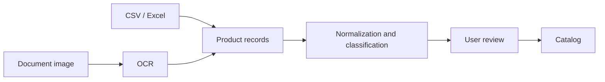

# MegaShop — Intelligent Retail Management

A retail management application built with Next.js, TypeScript and Supabase.

## Product imports

One of the problems I wanted to address was the amount of manual work involved in entering products from supplier documents.

The import module accepts CSV and Excel files as well as photographs of documents. Spreadsheet data is parsed using XLSX. Images go through an OCR workflow backed by a vision model. The application also combines keyword-based and model-based classification to assign product categories.



The review step matters: an incorrect quantity, barcode or cost can affect stock and pricing.

The import process normalizes product identifiers, costs, sale prices, quantities and categories. It also searches for similar existing products and lets the operator decide whether to merge a match or create a new item. AI provider calls are handled through server routes.

## Inventory and access control

The application uses Supabase Auth and PostgreSQL. Access is designed around user roles, branch assignments and row-level security (RLS), rather than relying on the interface alone. Catalog and stock views include location-specific data, price history and inventory movements. The maintenance interface provides access to error logs and user activity for administrators.

I'm also working on inventory monitoring: identifying duplicates, reviewing products with no movement over a monthly period and using that information to help decide which items to promote. The import-time similarity check is present in the repository; continuous monitoring and monthly reporting still need separate validation.

## Connecting retail inventory to AutoPilot

The next step is to connect MegaShop with DOTCOM's AutoPilot AI. The idea is to match trends relevant to the shop's niche against available inventory, select suitable products and prepare or publish promotional content through connected social accounts.

This is the proposed integration for an autonomous e-commerce workflow, not a completed end-to-end integration. Stock availability, prices and publishing permissions need to remain under the merchant's control.

## Development

```bash
npm install
npm run dev
```

Open `http://localhost:3000`. Configure a development Supabase project and the required environment variables before using authenticated workflows. The OCR and classification endpoints also require model provider configuration.

Other scripts: `npm run build`, `npm run start`, `npm run lint`.

The system is under active development. I'm still working on transaction consistency and access-control validation; the public code should not be treated as a production security reference.

[Related architecture notes](https://github.com/emamoreno7/emamoreno7/blob/main/showcase/enterprise-saas.md)
